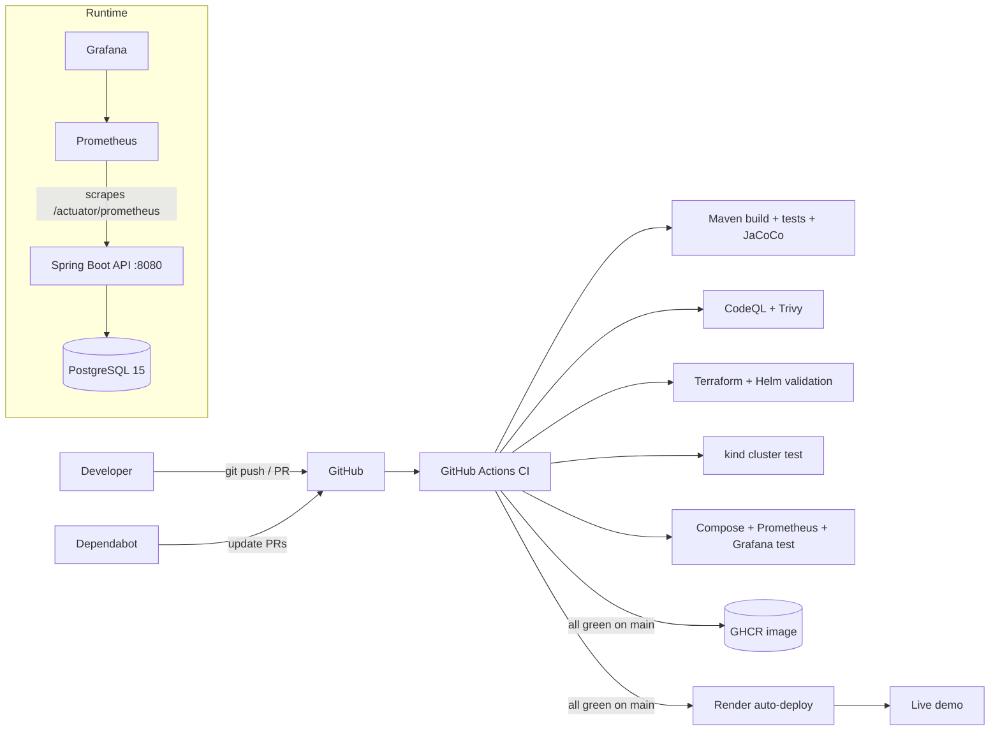

# SmartCampus


REST API for booking rooms on a university campus. It lists rooms (amphitheatres, labs, classrooms) and stores reservations by room, person, date and time slot. It is also a DevOps showcase: containerised, deployed on Kubernetes, and built through a CI/CD pipeline with a security scan.

**Live demo:** https://smartcampus-4mpm.onrender.com (free tier, sleeps after 15 minutes idle, so the first request can take about a minute. Demo data is fictional and resets on restart. The demo runs on an in-memory H2 database.)

## Architecture



- **Docker Compose**: `api` (port 8082 on the host) and `db` (PostgreSQL with a healthcheck, data in a named volume). Credentials come from `.env`. The optional `monitoring` profile adds Prometheus (9090) and Grafana (3000).
- **Kubernetes** (`k8s/`): `smartcampus` Deployment (3 replicas, probes on `/actuator/health`) behind a ClusterIP Service, a `postgres` Deployment and Service, a ConfigMap and a Secret.
- **Helm** (`helm/smartcampus/`): the same stack as a chart, with `values-dev.yaml`, `values-staging.yaml` and `values-prod.yaml`.
- **Terraform** (`terraform/`): the Render web service described as code.

## Tech stack

Java 17, Spring Boot 3.2.5 (Web, Data JPA, Actuator), PostgreSQL 15 (H2 for tests and the hosted demo), Maven, Docker (multi-stage, non-root), Kubernetes, Helm, GitHub Actions, Trivy, GHCR.

## Quickstart

```bash
git clone https://github.com/Yassinehabachi/smartcampus.git
cd smartcampus
cp .env.example .env        # then set POSTGRES_PASSWORD
docker compose up --build
```

The API is at http://localhost:8082. The Docker build compiles the app itself, so no local Java or Maven is needed.

Without Docker: `mvn spring-boot:run -Dspring-boot.run.profiles=demo` starts the API on port 8080 with an in-memory database.

## API

| Method | Path | Description |
| --- | --- | --- |
| GET | `/` | Welcome message |
| GET | `/api/rooms` | List rooms |
| GET | `/api/rooms/{id}` | One room (404 if unknown) |
| POST | `/api/rooms` | Create a room |
| GET | `/api/reservations` | List reservations |
| POST | `/api/reservations` | Create a reservation (400 if `roomId` is unknown) |
| GET | `/actuator/health` | Health check |

```bash
curl http://localhost:8082/api/rooms

curl -X POST http://localhost:8082/api/rooms \
  -H 'Content-Type: application/json' \
  -d '{"name":"Salle TD 12","capacity":40}'

curl -X POST http://localhost:8082/api/reservations \
  -H 'Content-Type: application/json' \
  -d '{"roomId":1,"reservedBy":"Yassine","date":"2026-11-10","timeSlot":"08:30-10:30"}'
```

## DevOps lifecycle

| Stage | What is in the repo | Where it runs |
| --- | --- | --- |
| Plan and code | Git, pull requests, Dependabot (Maven, Docker, Actions, Terraform) | GitHub |
| Build | Maven, multi-stage Dockerfile (non-root runtime) | CI |
| Test | 7 JUnit/MockMvc tests on H2, JaCoCo coverage report (artifact) | CI |
| Code and supply-chain security | CodeQL (Java), Trivy image scan with results in the Security tab | CI |
| Infrastructure as Code | Terraform config (`terraform fmt` + `validate`), Helm lint and template for dev/staging/prod | CI |
| Integration test | `docker compose --profile monitoring up`: API, Postgres, Prometheus scraping the API, Grafana with the provisioned dashboard | CI |
| Kubernetes test | kind cluster: raw manifests, then the Helm chart, each checked through a Service | CI |
| Release | Image pushed to GHCR (`latest` and commit SHA), only when every job above passed | CI, `main` only |
| Deploy (CD) | Render builds from `main` after CI checks pass, then a CI job waits for `/actuator/health` and calls the live API | Render + CI |
| Monitor | Actuator health probes, Prometheus metrics at `/actuator/prometheus`, Grafana dashboard "SmartCampus API Overview" | Compose |

### Environments

| Environment | Compose | Helm | Spring profile |
| --- | --- | --- | --- |
| dev | `docker compose -f compose.yaml -f compose.dev.yaml up --build` | `-f helm/smartcampus/values-dev.yaml` | `dev` (debug logs, SQL output) |
| staging | `docker compose -f compose.yaml -f compose.staging.yaml up -d` (uses the GHCR image) | `-f helm/smartcampus/values-staging.yaml` | `staging` |
| prod | n/a | `-f helm/smartcampus/values-prod.yaml --set postgresql.password=...` | `prod` |
| hosted demo | n/a | n/a | `demo` (in-memory H2) |

### Monitoring

```bash
docker compose --profile monitoring up --build
```

Prometheus: http://localhost:9090. Grafana: http://localhost:3000 (login from `GRAFANA_USER` and `GRAFANA_PASSWORD` in `.env`, default admin/admin). The dashboard shows request rate, response time, JVM heap, CPU, DB connections and 5xx rate.

### Jenkins

```bash
docker compose --profile cicd up --build -d
```

Jenkins runs at http://localhost:8085 (user `admin`, password from `JENKINS_ADMIN_PASSWORD` in `.env`). The image in `jenkins/` is configured as code (`casc.yaml`): admin user and a `smartcampus` pipeline job that reads the `Jenkinsfile` from this repository. Stages: Checkout, Build, Test (JUnit results), Docker build, Trivy scan, Push to the local registry (`localhost:5000`), Deploy (container on port 8090), Smoke test. The `jenkins-e2e` job in GitHub Actions starts this stack, runs the pipeline and requires `SUCCESS`. Jenkins mounts the Docker socket and runs as root, which is fine for a lab and not for production.

### Pipeline files

- `.github/workflows/ci-cd.yml`: build, test, scans, validation, compose and kind tests, publish, deploy check.
- `.github/workflows/codeql.yml`: CodeQL on push, pull request and weekly.
- `.github/dependabot.yml`: weekly dependency updates.
- `Jenkinsfile`: build and test stages, kept as an alternative pipeline.

## Kubernetes

```bash
docker build -t smartcampus:1.0 .
kubectl apply -f k8s/
# or with Helm
helm install smartcampus helm/smartcampus -f helm/smartcampus/values-dev.yaml \
  --set image.repository=smartcampus --set image.tag=1.0
```

The k8s Secret, the Postgres manifest and the default Helm values hold demo credentials. Replace them before any real use.

## Infrastructure as Code

`terraform/` describes the hosted demo (a Render Docker web service). It is checked in CI with `terraform fmt -check` and `terraform validate`. It is not applied automatically: the live service was created in the Render dashboard. To use it: set `RENDER_API_KEY` and `RENDER_OWNER_ID`, then `terraform init && terraform apply`.

## Tests

```bash
mvn test
```

Tests use the `test` profile (in-memory H2), so no database is required.
